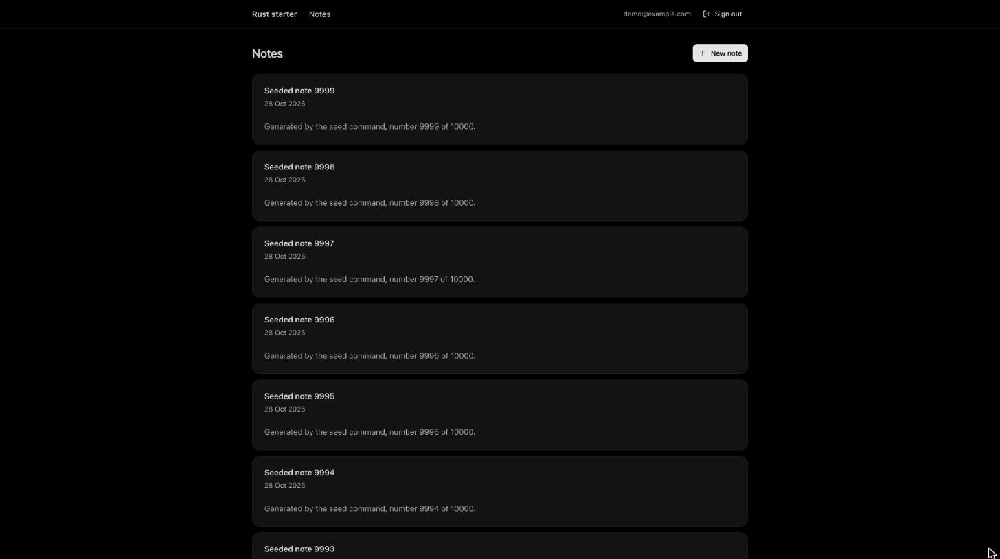
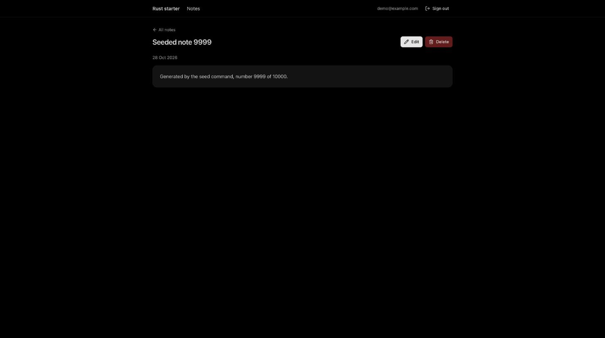
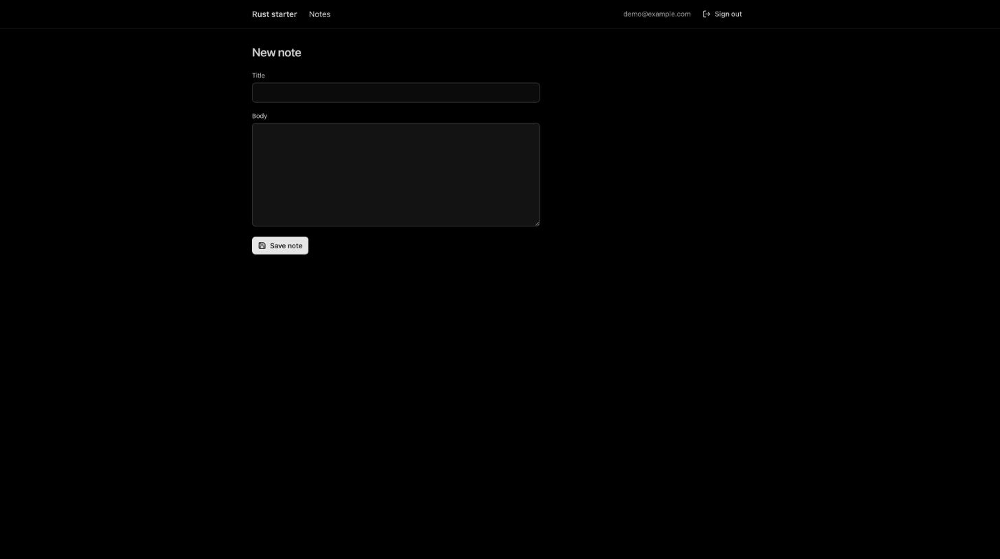

# Rust starter

A containerised Dioxus fullstack scaffold for web apps: Rust on the server and in the browser, Postgres, accounts and a
production image. Built in phases while learning Rust, then benchmarked against the same app written in Nuxt.



## Run it

Needs Docker only.

1. `docker compose up --build`
2. Open [localhost:8090](http://localhost:8090) and create an account. The first build takes a few minutes; later edits
   hot reload.
3. In VS Code, run **Dev Containers: Reopen in Container** to get rust-analyzer inside the `app` container.

Fill an account with 10,000 generated notes:

```sh
docker compose exec app cargo run --no-default-features --features server -- seed you@example.com 10000
```

Checks (format, clippy for server and browser, tests; the database tests need the stack running):

```sh
docker compose exec app ./scripts/check.sh
```

Production image:

```sh
docker build --target prod -t rust-starter .
docker run -p 8080:8080 -e DATABASE_URL=postgres://... -e PUBLIC_URL=https://your.domain rust-starter
```

## What we built

| Step | Result |
|---|---|
| Research | Compared Rust options with a Nuxt or Next feel (Leptos, Dioxus, Topcoat, Loco, Tuono, rari) and picked Dioxus 0.7, later moved to 0.8 alpha for hot-patching |
| [Plan](docs/STARTER.md) | Five phases with acceptance criteria, written before any code |
| 1. Container | Docker dev setup with hot reload, a VS Code dev container and a check script; nothing but Docker on the host |
| 2. Routing | Route enum, shared layout, real 404 status, stock shadcn-style components, light and dark theme |
| 3. Database | Postgres with SeaORM, migrations behind an advisory lock, paginated notes with totals, validated forms |
| 4. Auth | Accounts with Argon2id, server-side sessions, an origin check, owner-scoped queries, soft delete and an audit trail |
| 5. Production | Slim non-root image with pre-compressed assets and a healthcheck |
| Faster dev loop | The mold linker with lighter debug info, and Dioxus 0.8 alpha with Rust hot-patching in the server and browser ([why](docs/design-notes.md#hot-patching)); 0.7 without them stays on [`dioxus-0.7`](https://github.com/bsye/rust-starter/tree/dioxus-0.7) |
| [Benchmark](bench/REPORT.md) | The same app built the idiomatic Nuxt way in [`bench/nuxt`](bench/nuxt), measured on features, the developer loop and production by one script ([method](docs/BENCHMARK.md)) |

Learning Rust was part of the goal: [docs/rust-notes.md](docs/rust-notes.md) maps every Rust concept each phase used to
the file and line where it appears. Decisions, measurements and the three upstream Dioxus bugs we worked around are in
[docs/design-notes.md](docs/design-notes.md).

## Tour

| Note | New note |
|---|---|
|  |  |

## Docs

- [Plan](docs/STARTER.md)
- [Design notes](docs/design-notes.md)
- [Rust notes](docs/rust-notes.md)
- [Benchmark plan](docs/BENCHMARK.md) and [report](bench/REPORT.md)
