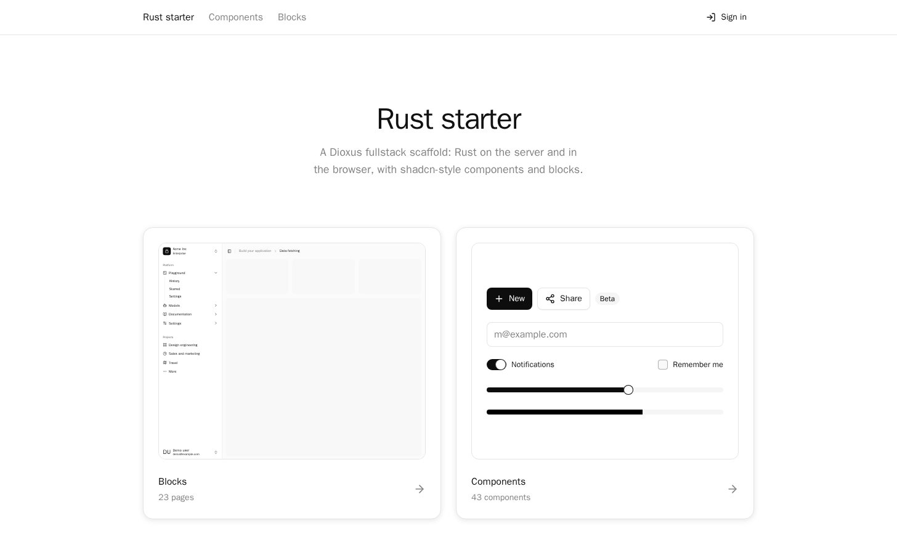
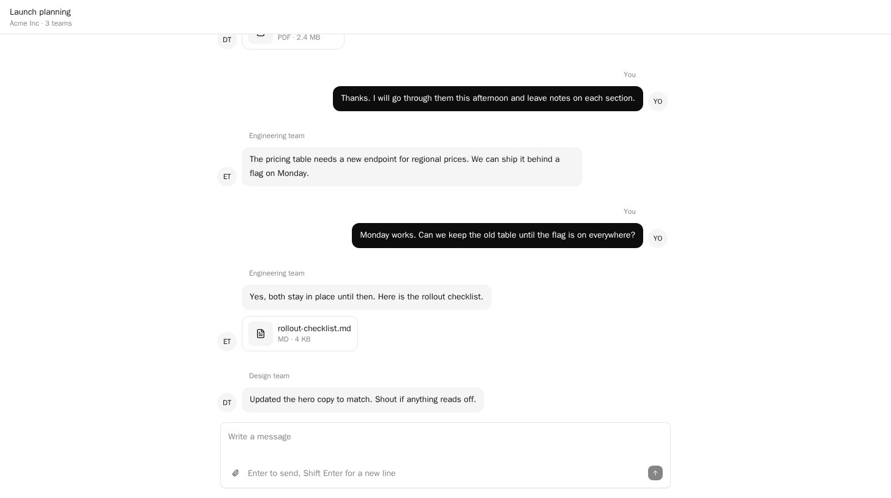
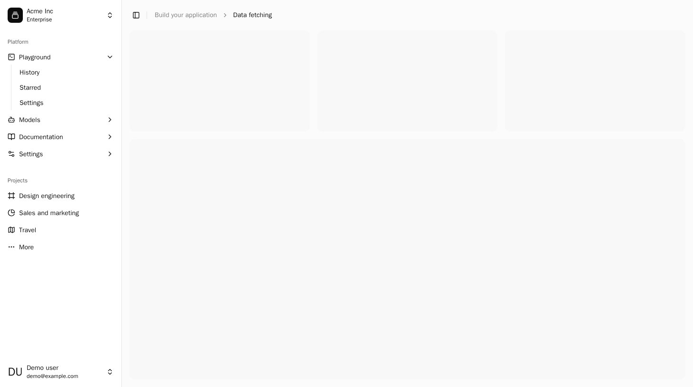
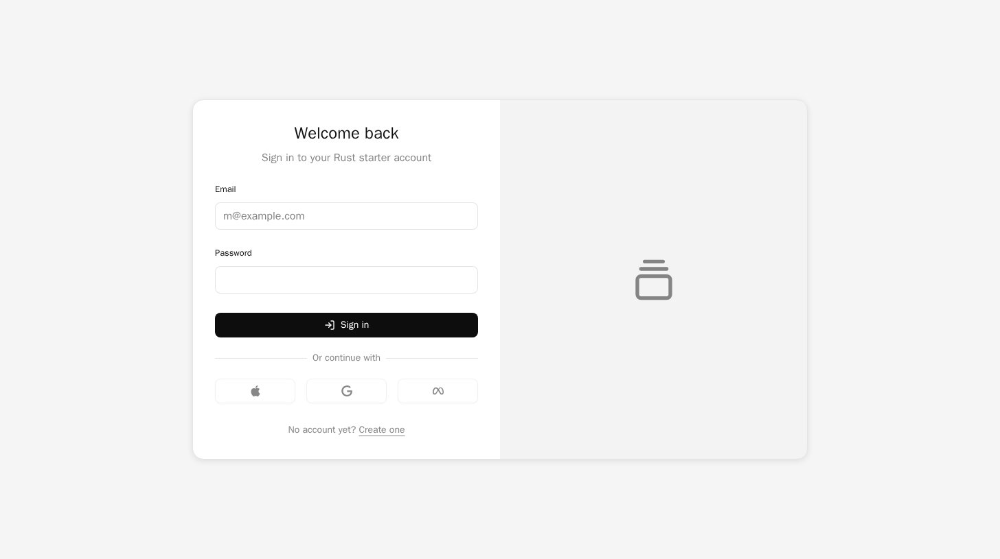

# Rust starter

Full-stack web apps in Rust: Dioxus on the server and in the browser, Postgres, accounts, shadcn-style components and
ready-made pages, all from one `docker compose up`. Built while learning Rust, then
[benchmarked](bench/REPORT.md) against the same app written in Nuxt.

<picture>
  <source media="(prefers-color-scheme: dark)" srcset="docs/screenshots/home-dark.jpg">
  
</picture>

## Run it

Needs Docker only.

1. `docker compose up --build`
2. Open [localhost:8090](http://localhost:8090). The first build takes a few minutes; after that, Rust edits hot-patch
   into the running server and browser.
3. In VS Code, run **Dev Containers: Reopen in Container** to get rust-analyzer inside the `app` container.

<details>
<summary>Sample data, checks, analytics and the production image</summary>

Fill an account with 10,000 generated notes:

```sh
docker compose exec app cargo run --no-default-features --features server -- seed you@example.com 10000
```

Checks (format, clippy for server and browser, tests; the database tests need the stack running):

```sh
docker compose exec app ./scripts/check.sh
```

Analytics are off until `POSTHOG_PROJECT_TOKEN` and `POSTHOG_HOST` are both set, in `.env` for development or as
environment variables in production ([why](docs/design-notes.md#analytics-through-posthog)).

Production image:

```sh
docker build --target prod -t rust-starter .
docker run -p 8080:8080 -e DATABASE_URL=postgres://... -e PUBLIC_URL=https://your.domain rust-starter
```

</details>

## Tour

<table>
  <tr>
    <td colspan="2">
      <picture>
        <source media="(prefers-color-scheme: dark)" srcset="docs/screenshots/chat-dark.jpg">
        
      </picture>
      <p align="center"><b>Chat</b>: shadcn's chat components ported to Dioxus in
      <a href="https://github.com/bsye/dioxus-registry">our registry</a></p>
    </td>
  </tr>
  <tr>
    <td width="50%">
      <picture>
        <source media="(prefers-color-scheme: dark)" srcset="docs/screenshots/sidebar-dark.jpg">
        
      </picture>
      <p align="center"><b>Sidebar</b>: an app shell to start from</p>
    </td>
    <td width="50%">
      <picture>
        <source media="(prefers-color-scheme: dark)" srcset="docs/screenshots/login-dark.jpg">
        
      </picture>
      <p align="center"><b>Login</b>: one of the sign-in and sign-up pages</p>
    </td>
  </tr>
</table>

Every page in `/blocks` runs live next to its source, and `/components` shows every installed component.

## Docs

| Doc | What's in it |
|---|---|
| [What we built](docs/STARTER.md#what-we-built) | Each step from research to production, and the plan it followed |
| [Components](docs/COMPONENTS.md), [blocks](docs/BLOCKS.md) and [chat](docs/CHAT.md) | How the component catalog, the page gallery and the chat components are built and installed |
| [Design notes](docs/design-notes.md) | Decisions, measurements and the three upstream Dioxus bugs we worked around |
| [Rust notes](docs/rust-notes.md) | Every Rust concept each phase used, mapped to the file and line where it appears |
| [Benchmark](bench/REPORT.md) | The same app built the idiomatic Nuxt way, measured on features, the developer loop and production ([method](docs/BENCHMARK.md)) |
