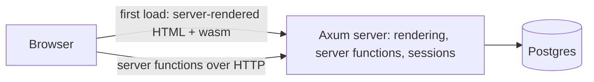

# Rust starter plan

A containerised Dioxus fullstack scaffold for web apps, built in small phases so each one teaches a slice of Rust.

## Goals

- `docker compose up` gives a running app with hot reload and Postgres. Nothing installed on the Mac but Docker.
- Every pattern a real app needs, shown once on a sample resource (notes): pages, server functions, database, auth,
  tests, production image.
- Learn Rust along the way: each phase names the concepts it introduces, and `docs/rust-notes.md` maps them to the files
  where they appear. SQL is not a learning goal: queries and migrations are Rust code.

**Out of scope for v1:** desktop and mobile, background jobs, admin page, CI (no git remote yet), deploying to a host.

## Stack

Versions checked on 2026-10-28 against crates.io and Docker Hub. Reasons in [design-notes.md](design-notes.md).

| Layer | Choice | Version |
|---|---|---|
| Language | Rust (`rust:1.99-trixie` image) | 1.99.1 |
| UI and server | [Dioxus](https://dioxuslabs.com/learn/0.7/) fullstack | 0.7.10 |
| CLI | dioxus-cli (`dx`) | 0.7.10 |
| HTTP | Axum, through Dioxus | 0.8 |
| Database | Postgres | 18 |
| Database access | [SeaORM](https://www.sea-ql.org/SeaORM/), queries and migrations in Rust | 2.0.4 |
| Sessions and auth | [axum_session_auth](https://github.com/AscendingCreations/AxumSessionAuth) + axum_session_sqlx | 0.22 / 0.12 |
| Password hashing | argon2 | 0.6.0 |
| Components | [dioxus-components](https://github.com/DioxusLabs/dioxus-components) (shadcn style, `dx components add`) | latest |
| Styling | Tailwind v4, watcher started by `dx` | v4 |
| Errors | thiserror | 2.0 |

## Shape



```
Cargo.toml        one crate, features: web, server
Dioxus.toml
tailwind.css
assets/
src/
  main.rs         dioxus::serve on the server, dioxus::launch in the browser
  app.rs          route enum and layout
  pages/          one file per route
  components/     output of dx components add, plus shared UI
  api/            server functions (compiled into both sides, bodies run on the server only)
  server/         server only: config, database, entities, migrations, auth
compose.yaml      app + db
Dockerfile        dev and prod stages
.devcontainer/    VS Code attaches to the app service
```

## Dev environment

- `app` service: Rust 1.99, the wasm target, `dx` 0.7.10 installed with cargo-binstall.
- `db` service: `postgres:18` with a named volume.
- Source is bind-mounted; `target/` and the cargo registry live in named volumes so builds stay fast on macOS.
- `dx serve` listens on `0.0.0.0:8080` inside the container; hot reload uses the same port.
- Every cargo and dx command runs through `docker compose exec app ...`.
- VS Code opens the project inside the `app` container (Dev Containers), so rust-analyzer uses the same toolchain.

## Phases

Every phase ends with tests, clippy and rustfmt passing, a check in the browser, a walkthrough in chat, and a new section
in `docs/rust-notes.md`.

| # | Phase | Delivers | Rust you meet |
|---|---|---|---|
| 1 | Container and hello | Compose stack, home page, `/health`, hot reload, clippy fails on warnings | Cargo, crates, modules, `fn main`, macros (`rsx!`), features and `cfg` |
| 2 | Routing and layout | Route enum, shared layout, 404 page, first stock components, light and dark theme | enums, `derive`, structs, component props, ownership and borrowing, `String` vs `&str` |
| 3 | Database | Config from env, pool, migrations at startup, notes list (paginated, with total) and detail and create form | `Result`, `?`, `Option`, error enums, `async`/`await`, traits (`Serialize`, `FromRow`) |
| 4 | Auth | Sign up, sign in, sign out, sessions in Postgres, protected pages, reads scoped to the user, edit and delete notes, who and when on every change | `Arc`, `Clone`, lifetimes (basics), Axum extractors, middleware, generics |
| 5 | Production image | Multi-stage Dockerfile (cargo-chef, `dx bundle`, slim runtime, non-root), measured size and start time | release profile, build caching, linking |

### Acceptance criteria

**Phase 1**
- GIVEN a fresh clone, WHEN I run `docker compose up`, THEN `localhost:8080` shows the home page and `/health` returns
  `ok`.
- GIVEN the app is running, WHEN I edit markup inside `rsx!`, THEN the browser updates without a reload.
- GIVEN code with a warning, WHEN clippy runs, THEN it fails. A pinned clippy rule rejects `regex::Regex`.

**Phase 2**
- GIVEN any page, WHEN I click a link, THEN it navigates without a full reload; WHEN I open the URL directly, THEN the
  HTML arrives already rendered (visible in view-source).
- GIVEN an unknown URL, THEN a 404 page offers a link home.
- GIVEN the system is in dark mode, THEN the theme switches with no custom colours.

**Phase 3**
- GIVEN `DATABASE_URL` is missing, WHEN the app starts, THEN it exits with an error naming the variable.
- GIVEN 10,000 seeded notes, WHEN I open the list, THEN the first page renders with the total count, the page size comes
  from one constant, and the response time is measured and recorded.
- GIVEN invalid form input, THEN the field shows an error and nothing is saved.
- GIVEN a note id that does not exist, THEN the detail page shows "not found".

**Phase 4**
- GIVEN I am signed out, WHEN I open a notes page, THEN I am sent to sign in, and server functions return 401.
- GIVEN users A and B, WHEN A lists notes, THEN A sees only A's notes; WHEN A opens B's note URL, THEN it is "not found".
  The scoping lives in one query layer every read goes through, with a test that pins it.
- GIVEN any create, update or delete, THEN the user and time are recorded.
- GIVEN a duplicate email at sign up, THEN a clear error shows and no second account exists.

**Phase 5**
- GIVEN `docker build --target prod`, THEN the image holds only the server binary and public assets, runs as non-root,
  applies migrations at startup and passes its healthcheck.
- Image size and cold start time are measured and written into the README.

## Edge cases to cover

- Hydration mismatches: anything random or time-based must load through `use_server_future` or render after hydration.
- Pages past the last one return an empty page with the real total, never an error.
- Two app replicas starting at once must not run migrations twice (verify SeaORM's migrator behaviour in phase 3).
- Session cookies: `Secure` and `HttpOnly` in prod, relaxed only for `localhost` in dev.
- Mac builds are arm64; the prod image needs an amd64 build for most hosts.

## Decisions

| Topic | Decision |
|---|---|
| Editor | VS Code Dev Containers attached to the `app` service |
| Learning style | Each phase is built, then walked through in chat and in `docs/rust-notes.md` (Rust only, no SQL) |
| Sample resource | Notes |
| Browser tests | Deferred until CI exists; every phase is checked in the browser. A Rust WebDriver client is the default, since Playwright would add TypeScript |
| Git | Work on the `scaffold` branch, one commit per phase. No remote yet |
