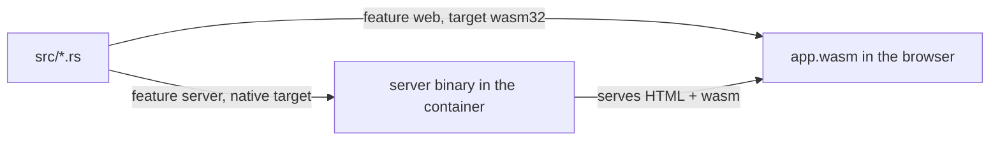

# Rust notes

The Rust each phase introduced, mapped to the files where it appears. Links go to
[The Rust Book](https://doc.rust-lang.org/book/) unless noted.

## Phase 1: container and hello

`dx serve` compiles the same crate twice, with different features, and runs both halves.

| Concept | Where | In one line | Read |
|---|---|---|---|
| Package and lockfile | `Cargo.toml`, `Cargo.lock` | The manifest names the crate and its dependencies; the lockfile pins exact versions | [ch01-03](https://doc.rust-lang.org/book/ch01-03-hello-cargo.html) |
| Features | `Cargo.toml` `[features]` | Named switches: `web` pulls in the browser renderer, `server` pulls in Axum and `anyhow` | [Cargo features](https://doc.rust-lang.org/cargo/reference/features.html) |
| `cfg` | `src/main.rs:2`, `:6`, `:9` | `#[cfg(feature = "server")]` keeps the next item only in the server build | [Reference](https://doc.rust-lang.org/reference/conditional-compilation.html) |
| Modules | `src/main.rs:1-3` | `mod app;` loads `src/app.rs`, `mod server;` loads `src/server/mod.rs`; items are private unless marked `pub` | [ch07-02](https://doc.rust-lang.org/book/ch07-02-defining-modules-to-control-scope-and-privacy.html), [ch07-05](https://doc.rust-lang.org/book/ch07-05-separating-modules-into-different-files.html) |
| `use` and paths | `src/server/mod.rs:1`, `crate::app::App` at `:4` | `use` brings names into scope; `crate::` starts from the crate root | [ch07-02](https://doc.rust-lang.org/book/ch07-02-defining-modules-to-control-scope-and-privacy.html) |
| Macros | `rsx!`, `asset!`, `#[component]` in `src/app.rs` | Code that writes code at compile time: `name!(...)` is a function-like macro, `#[name]` an attribute macro | [ch20-05](https://doc.rust-lang.org/book/ch20-05-macros.html) |
| `const` | `src/app.rs:3` | A value fixed at compile time, always with its type written out | [ch03-01](https://doc.rust-lang.org/book/ch03-01-variables-and-mutability.html) |
| Functions as values | `src/main.rs:7` | `server::router` is passed without `()`; `serve` calls it, and calls it again after a hot patch | [ch13-01](https://doc.rust-lang.org/book/ch13-01-closures.html) |
| `async fn` | `src/server/mod.rs:3`, `:7` | Returns a future, a value that finishes later; the Tokio runtime inside `serve` drives it | [ch17](https://doc.rust-lang.org/book/ch17-00-async-await.html) |
| `Result` and `Ok` | `src/server/mod.rs:3-4` | A value that is either `Ok(value)` or `Err(error)`; `anyhow::Result<T>` fixes the error type to `anyhow::Error` | [ch09-02](https://doc.rust-lang.org/book/ch09-02-recoverable-errors-with-result.html) |
| `&'static str` | `src/server/mod.rs:7` | A borrowed string that lives for the whole program, which every string literal does | [ch10-03](https://doc.rust-lang.org/book/ch10-03-lifetime-syntax.html) |
| The never type `!` | `dioxus::serve` | A function that never returns; `serve` runs the server until the process stops | [ch20-03](https://doc.rust-lang.org/book/ch20-03-advanced-types.html) |
