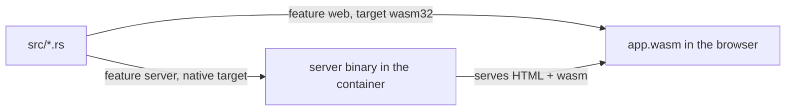

# Rust notes

The Rust each phase introduced, mapped to the files where it appears. Links go to
[The Rust Book](https://doc.rust-lang.org/book/) unless noted.

## Phase 1: container and hello

`dx serve` compiles the same crate twice, with different features, and runs both halves.

| Concept | Where | In one line | Read |
|---|---|---|---|
| Package and lockfile | `Cargo.toml`, `Cargo.lock` | The manifest names the crate and its dependencies; the lockfile pins exact versions | [ch01-03](https://doc.rust-lang.org/book/ch01-03-hello-cargo.html) |
| Features | `Cargo.toml` `[features]` | Named switches: `web` pulls in the browser renderer, `server` pulls in Axum and `anyhow` | [Cargo features](https://doc.rust-lang.org/cargo/reference/features.html) |
| `cfg` | `src/lib.rs:4`, `:9`, `:12` | `#[cfg(feature = "server")]` keeps the next item only in the server build | [Reference](https://doc.rust-lang.org/reference/conditional-compilation.html) |
| Modules | `src/lib.rs:1-6` | `mod app;` loads `src/app.rs`, `mod server;` loads `src/server/mod.rs`; items are private unless marked `pub` | [ch07-02](https://doc.rust-lang.org/book/ch07-02-defining-modules-to-control-scope-and-privacy.html), [ch07-05](https://doc.rust-lang.org/book/ch07-05-separating-modules-into-different-files.html) |
| `use` and paths | `src/server/mod.rs:1`, `crate::app::App` at `:4` | `use` brings names into scope; `crate::` starts from the crate root | [ch07-02](https://doc.rust-lang.org/book/ch07-02-defining-modules-to-control-scope-and-privacy.html) |
| Macros | `rsx!`, `asset!`, `#[component]` in `src/app.rs` | Code that writes code at compile time: `name!(...)` is a function-like macro, `#[name]` an attribute macro | [ch20-05](https://doc.rust-lang.org/book/ch20-05-macros.html) |
| `const` | `src/app.rs:5-6` | A value fixed at compile time, always with its type written out | [ch03-01](https://doc.rust-lang.org/book/ch03-01-variables-and-mutability.html) |
| Functions as values | `src/lib.rs:10` | `server::router` is passed without `()`; `serve` calls it, and calls it again after a hot patch | [ch13-01](https://doc.rust-lang.org/book/ch13-01-closures.html) |
| `async fn` | `src/server/mod.rs:3`, `:7` | Returns a future, a value that finishes later; the Tokio runtime inside `serve` drives it | [ch17](https://doc.rust-lang.org/book/ch17-00-async-await.html) |
| `Result` and `Ok` | `src/server/mod.rs:3-4` | A value that is either `Ok(value)` or `Err(error)`; `anyhow::Result<T>` fixes the error type to `anyhow::Error` | [ch09-02](https://doc.rust-lang.org/book/ch09-02-recoverable-errors-with-result.html) |
| `&'static str` | `src/server/mod.rs:7` | A borrowed string that lives for the whole program, which every string literal does | [ch10-03](https://doc.rust-lang.org/book/ch10-03-lifetime-syntax.html) |
| The never type `!` | `dioxus::serve` | A function that never returns; `serve` runs the server until the process stops | [ch20-03](https://doc.rust-lang.org/book/ch20-03-advanced-types.html) |

## Phase 2: routing and layout

| Concept | Where | In one line | Read |
|---|---|---|---|
| Library and binary crates | `src/lib.rs`, `src/main.rs` | All code lives in the library; `main.rs` only calls `rust_starter::run()`. `pub mod components` makes the generated components a public API, so unused variants are not dead code | [ch07-01](https://doc.rust-lang.org/book/ch07-01-packages-and-crates.html) |
| Enums with data | `src/app.rs:9-17` | Each route is a variant; `NotFound { segments: Vec<String> }` carries the unmatched path pieces | [ch06-01](https://doc.rust-lang.org/book/ch06-01-defining-an-enum.html) |
| `derive` | `src/app.rs:8` | Asks the compiler (or a macro, like `Routable`) to write trait implementations for you | [Appendix C](https://doc.rust-lang.org/book/appendix-03-derivable-traits.html) |
| `impl` and `match` | `src/components/button/component.rs:20-31` | Methods on an enum; `match` must cover every variant or it will not compile | [ch05-03](https://doc.rust-lang.org/book/ch05-03-method-syntax.html), [ch06-02](https://doc.rust-lang.org/book/ch06-02-match.html) |
| `String` vs `&str` | `NAV_LINK` in `src/pages/shell.rs:5`, `title: String` in `src/ui/page_header.rs:4` | `&str` borrows text someone else owns; `String` owns its text. Component props must be owned, so they take `String`, and the literal `"Notes"` is converted for you | [ch08-02](https://doc.rust-lang.org/book/ch08-02-strings.html), [ch04-03](https://doc.rust-lang.org/book/ch04-03-slices.html) |
| Ownership and moves | `to,` in `src/ui/button_link.rs:19` | Passing `to` hands the value over; `ButtonLink` cannot use it afterwards, and does not need to | [ch04-01](https://doc.rust-lang.org/book/ch04-01-what-is-ownership.html) |
| Traits: `Into` and `Default` | `#[props(into)]` and `#[props(default)]` in `src/ui/button_link.rs:10-11` | `into` accepts anything convertible (a `Route` becomes a `NavigationTarget`); `default` uses the type's `Default` value when the prop is left out | [ch10-02](https://doc.rust-lang.org/book/ch10-02-traits.html) |
| Associated functions | `FullstackContext::commit_http_status` in `src/pages/not_found.rs:15` | A function on a type with no `self`, called with `Type::function`; on the server it sets the response to 404, in the browser it does nothing | [ch05-03](https://doc.rust-lang.org/book/ch05-03-method-syntax.html) |
| `Option` | `None` in `src/pages/not_found.rs:15` | Rust has no null: an optional value is `Some(value)` or `None` | [ch06-01](https://doc.rust-lang.org/book/ch06-01-defining-an-enum.html) |
| Unit tests | `src/app.rs:28-45` | `#[cfg(test)]` compiles the module only for `cargo test`; `use super::Route` reaches the parent module; `unwrap()` panics on an error, which fails the test | [ch11-01](https://doc.rust-lang.org/book/ch11-01-writing-tests.html) |
